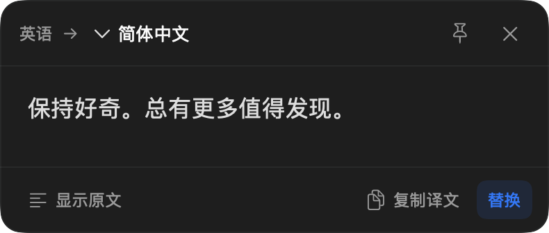
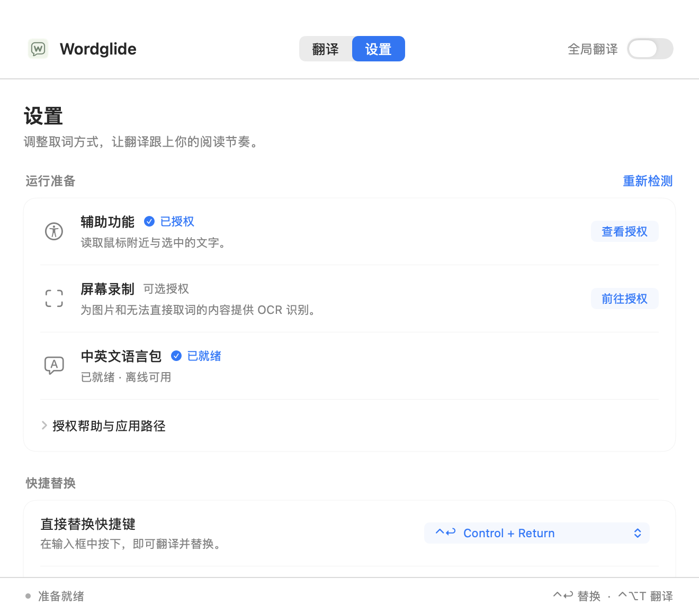

<p align="center">
  
</p>

<h1 align="center">Wordglide</h1>

<p align="center">
  <strong>A lightweight, native macOS menu bar translator</strong><br>
  English hover translation, selected-text translation, and quick replacement, powered by Apple’s on-device translation.
</p>

<p align="center">
  <a href="README.md">简体中文</a> · <strong>English</strong>
</p>

<p align="center">
  
  
  <a href="LICENSE"></a>
</p>

<p align="center">
  <a href="https://github.com/Jemzhao/Wordglide/releases">Downloads</a> · <a href="#features">Features</a> · <a href="#preview">Preview</a> · <a href="#installation-and-first-setup">Get started</a> · <a href="#usage">Shortcuts</a> · <a href="#documentation">Docs</a>
</p>

> Current version: **0.3.0**. See [GitHub Releases](https://github.com/Jemzhao/Wordglide/releases) for published downloads and release notes; availability depends on the assets attached to each release. Builds are locally self-signed, without Developer ID signing or Apple notarization. First launch may require allowing this app in macOS settings.

Paragraph hover translation, direct card opening on hover, and the new update channel are part of the upcoming 0.3.1 release. [Changelog](CHANGELOG.md#未发布)

## Features

Wordglide helps you translate English while reading and replace text while writing, without leaving the app you are using. It combines SwiftUI and AppKit with Apple’s local translation engine.

- **English hover translation** uses the paragraph under the pointer by default, with a setting to open the translation card directly.
- **Selected text, clipboard, and manual translation** — translate a selection, invoke a shortcut, or enter text in the main window.
- **Quick replacement in text fields** — translate Chinese into English or English into Simplified Chinese. Replace the selection, or the whole field when there is no selection and the editor supports it.
- **Native interface** — a menu bar app with a consistent translation workspace, settings, and floating cards. Copy, pin, expand the original text, or replace with one click. Light and dark appearances follow macOS.
- **Recovery after failures** — view and copy a translation that could not be inserted. Cancel a pending translation or retry after a timeout.
- **In-app updates** — Sparkle checks, downloads, and installs signed updates published through GitHub Releases.

## Preview

<p align="center">
  
</p>

<p align="center"><em>Translation workspace. The current app interface is in Chinese.</em></p>

| Light | Dark |
| --- | --- |
|  |  |

<details>
<summary>View the settings page</summary>

<p align="center">
  
</p>

</details>

The app and this page share the same pale-green W speech-bubble icon. These previews show the native 0.3.0 interface with sample text. [Icon assets and generation notes](Assets/README.md) · [Image notes](docs/images/README.md)

## Requirements

- **macOS 26 or later**.
- For building: full Xcode with an SDK that includes the macOS 26.4 Translation API.
- Verified development environment: Apple Silicon, macOS 27.0.1, Xcode 27.0, and Swift 6.4. Intel Macs and physical devices running macOS 26 have not yet been verified.

The Swift package uses Swift 5 language mode. Sparkle is pinned to version 2.10.0 in `Package.swift` and `Package.resolved`.

## Installation and first setup

### Install a release build

Visit [Releases](https://github.com/Jemzhao/Wordglide/releases) and follow the version’s notes to download the `arm64` DMG and its SHA-256 file. The package targets Apple Silicon Macs running macOS 26 or later. A locally signed DMG does not make the app trusted by macOS.

1. If Wordglide is already open, let any translation or replacement finish, then quit from the menu bar.
2. Open the DMG, drag Wordglide into **Applications**, and choose **Replace** if prompted.
3. Open the app from **Applications**. If macOS blocks this unnotarized build, verify the source first. You may need to allow this individual app in **System Settings → Privacy & Security**, following the system prompts. Device management policies may prevent it from opening.

Once 0.3.1 is published, users on 0.3.0 and earlier must install it manually to enter the new update channel. After opening 0.3.1, regrant Accessibility and Screen Recording for OCR if macOS asks. [Distribution guide in Chinese](docs/DISTRIBUTION.md#手动迁移到-031)

### Prepare languages and permissions

Wordglide starts with global translation paused. Open **Settings** (设置) in the main window:

1. Choose **Prepare language packs** (准备语言包) and confirm Apple’s download prompt. Keep the window open while it prepares both Chinese–English directions.
2. Grant **Accessibility** permission to the current Wordglide app for text capture, selection, and replacement.
3. If you want OCR, also grant **Screen Recording** permission. OCR requires Accessibility as well, so protected and password fields can be checked first.
4. Return to Wordglide, choose **Check again** (重新检测), and enable global translation. Quit from the menu bar and reopen the app if macOS requests a restart.

The sample translation card can show the original text and setup hints before language packs are ready. Settings also shows the current app path, with actions to copy it or reveal the app in Finder.

Keeping the same signing identity, app identifier, and installation path helps preserve permissions between builds. Changing identities requires authorization again; macOS policy changes may also require it.

## Usage

| Entry point | Default action |
| --- | --- |
| Hover translation | Hover over English for 600 ms by default to reveal the translation icon. Moving the pointer onto the icon opens the card. |
| Selected-text translation | Select text with the mouse, or press `Control + Option + T` to translate the current selection. The limit is 8,000 characters. |
| Quick replacement | Finish any input method composition, then press `Control + Return`. |
| Replace from a card | Review the translation and click **Replace** (替换) once. |
| Clipboard translation | Choose **Translate clipboard** (翻译剪贴板) from the menu bar. |
| Manual translation | Enter or paste up to 8,000 characters in the main window’s translation page. |

**Translate directly on hover** (悬停后直接显示译文) is off by default. Enable it in Settings to open the card after the same hover delay and text capture. Move the pointer into the card to use its controls.

Choose **Paragraph**, **Sentence / Phrase**, or **Word** under **Hover text scope** (悬停识别范围) in Settings. An upgrade keeps the old Word setting. Earlier versions saved the default and Sentence setting as the same value, so both move to Paragraph. Choices made in the new settings are saved.

Chinese translates into English by default; English translates into Simplified Chinese. The floating card’s language menu lets you change the target. Quick replacement settings support automatic Chinese–English direction, fixed English, or fixed Simplified Chinese. Alternative shortcuts are `Control + Option + R` and `Control + Option + Return`; `Command + X` remains the system Cut command.

A selection card stays open when the pointer leaves. Clicking or typing outside it, or closing it, dismisses the card; pin it to keep it visible. Closing the main window leaves Wordglide running in the menu bar without a persistent Dock icon. Pausing stops automatic capture and frequent event monitoring; explicit shortcuts, clipboard translation, and manual translation remain available.

### Replacement and recovery

- Replacement is available only when the app can verify an editable target, the complete original text, and an exact range. Typing, moving the cursor, switching fields, or changing apps while waiting invalidates the old request. Active input method composition, multiple selections, and attachments within the replacement range prevent submission.
- Each replacement sends one ordinary `Command + V` paste. Wordglide does not automatically repeat it. You can try `Command + Z` in the target editor; paste styling and undo behavior depend on that editor. The translation is plain text and does not preserve each word’s mixed formatting.
- Paste confirmation has a deadline of approximately 1.6 seconds, plus a final Accessibility read of up to 0.12 seconds. If the result is **uncertain**, check the original field before submitting another replacement.
- If a translation exists but replacement fails or cannot be confirmed, the main window keeps it in a recovery card for viewing and copying. Only the latest unfinished operation is retained in memory. Dismissing that recovery card or quitting clears it.
- Language-status checks and translation share a 30-second deadline. You can cancel while loading and retry manually after failure. A retry produces text for review and copying; trigger replacement again in the original field if needed. Language-pack downloads do not use this deadline.

## Privacy and compatibility

Wordglide itself does not upload text or screenshots, use third-party translation services or analytics, or persist screenshots, original text, or translation history. Apple downloads the required language packs. Once configured, update checks and downloads connect to GitHub; Sparkle system profiling is disabled. Preferences use UserDefaults, while translation caches and recovery records stay in process memory.

Replacement temporarily saves all readable clipboard formats and refuses to proceed if they cannot be preserved completely or exceed 32 MiB. Clipboard restoration does not overwrite new content you copy during the operation. Reading clipboard content **for translation** happens only when you explicitly choose clipboard translation.

Paragraph mode first uses the text exposed by the target app through Accessibility. When enabled, OCR can group nearby English lines in the same column. The result depends on the area captured in the screenshot, the layout, and recognition quality. Select text manually to specify the exact range. Replacement also depends on the target app’s Accessibility support. When editing cannot be verified reliably, ordinary translation and copying are still available. More input methods, rich text editors, physical multi-monitor setups, Spaces, full-screen apps, and VoiceOver still need scenario-specific testing. [Validation record, in Chinese](docs/VALIDATION.md)

## Development

Clone the source, then run these commands from the project root:

```sh
git clone https://github.com/Jemzhao/Wordglide.git
cd Wordglide
./scripts/test.sh
./scripts/setup-local-signing.sh
./scripts/build-app.sh
./scripts/run.sh
```

Swift Package Manager resolves the pinned Sparkle dependency. The current automated baseline is 130 XCTest cases plus the permission-free `--self-test`; test counts may change as the project develops.

`setup-local-signing.sh` is a one-time setup on each developer’s own Mac. It creates or reuses a local signing identity in the user’s Keychain, and macOS may ask for confirmation. Keep private keys on your own machine; do not copy the maintainer’s identity or commit signing material. The [development guide](docs/DEVELOPMENT.md) (in Chinese) explains existing certificate support and signing checks.

The default build uses the release configuration and produces `build/Wordglide.app`. `run.sh` only builds if that app is missing; rebuild explicitly after editing code. Use the packaged `.app` for permission-dependent testing rather than granting permissions to temporary binaries under `.build`.

To create a locally signed DMG and its SHA-256 file:

```sh
./scripts/package-dmg.sh
```

The current verified package targets Apple Silicon and macOS 26+. See [Contributing](CONTRIBUTING.md) (in Chinese) for development conventions and checks before submitting changes.

## Updates

The Sparkle release channel uses [Jemzhao/Wordglide Releases](https://github.com/Jemzhao/Wordglide/releases). Only a published stable release with a signed feed and update package provides an update. Local builds without feed configuration show that state and do not start an update client.

For maintainers, the [update guide](docs/UPDATES.md) (in Chinese) covers the separate Sparkle signing key, public GitHub repository configuration, and local release preparation. The scripts prepare signed files locally; they do not create a repository, upload assets, publish a release, or configure CI.

Starting with 0.3.1, maintainers prepare releases with the new channel.

```sh
./scripts/setup-updates.sh --repository Jemzhao/Wordglide --channel v2
./scripts/prepare-update.sh
```

Setup checks the Sparkle signing key in the maintainer's login Keychain. The key authenticates updates. The code-signing certificate identifies the app. Forks use their own repository and keys. Users can enable automatic checks, then confirm download and installation. Installation waits for current translation, replacement, and clipboard restoration to finish.

After manually installing 0.3.1, use **Check for Updates…** (检查更新…) from the menu bar for later releases. Each new Latest Release includes the new `appcast-v2.xml` feed and the original signed `appcast.xml` for 0.3.0 clients.

Sparkle update signatures verify the update contents; they do not replace Developer ID signing or Apple notarization. Translation and replacement continue to work when the update service is unavailable.

## Documentation

The detailed project guides below are currently in Chinese.

| Document | Contents |
| --- | --- |
| [Development](docs/DEVELOPMENT.md) | Toolchain, local signing, builds, and diagnostic commands |
| [Distribution](docs/DISTRIBUTION.md) | Local DMGs, installation, verification, and manual updates |
| [In-app updates](docs/UPDATES.md) | Sparkle keys, GitHub configuration, and release preparation |
| [Architecture](docs/ARCHITECTURE.md) | Source responsibilities and main application flows |
| [Contributing](CONTRIBUTING.md) | Development and contribution conventions |
| [Security](SECURITY.md) | Reporting issues and handling sensitive information |
| [Changelog](CHANGELOG.md) | Changes by version |
| [Validation](docs/VALIDATION.md) | Automated checks, device evidence, and remaining boundaries |

## License

Wordglide is available under the [MIT License](LICENSE). Parts of the base implementation are adapted from [HoverTranslate](https://github.com/Kianzzz/hover-translate), retaining Copyright (c) 2026 Kianzzz and the full upstream MIT license. The app also includes Sparkle and its component licenses. See [Third-party notices](THIRD_PARTY_NOTICES.md).
