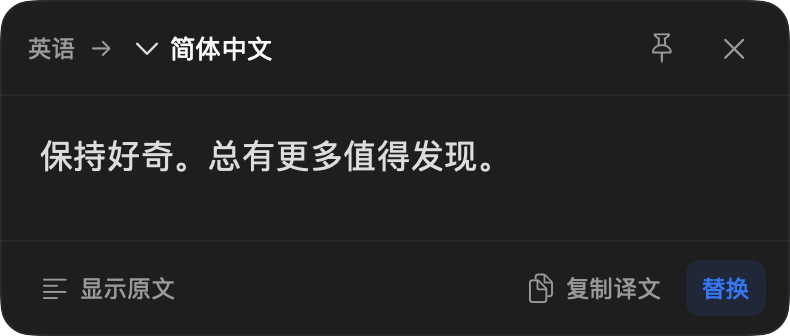
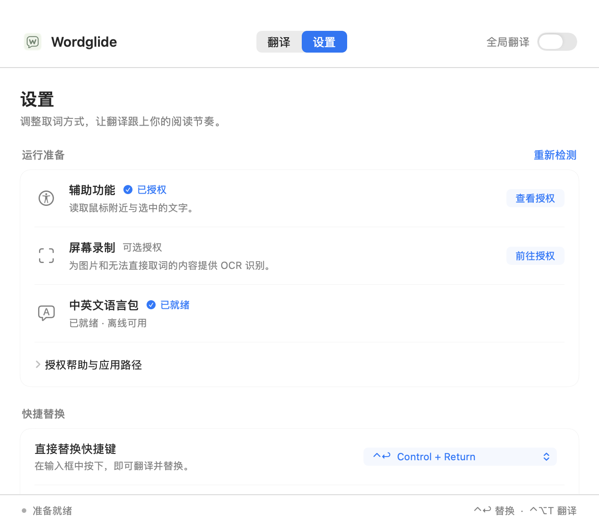

<p align="center">
  
</p>

<h1 align="center">Wordglide</h1>

<p align="center">
  <strong>原生轻量的 macOS 菜单栏翻译工具</strong><br>
  英文悬停、划词翻译、输入框快捷替换，使用 Apple 本机翻译引擎。
</p>

<p align="center">
  <strong>简体中文</strong> · <a href="README.en.md">English</a>
</p>

<p align="center">
  
  
  <a href="LICENSE"></a>
</p>

<p align="center">
  <a href="https://github.com/Jemzhao/Wordglide/releases">下载与发布</a> · <a href="#功能">功能</a> · <a href="#界面预览">界面预览</a> · <a href="#安装">开始使用</a> · <a href="#使用">快捷操作</a> · <a href="#项目文档">文档</a>
</p>

> 当前版本 **0.3.0**。安装包与发布说明见 [GitHub Releases](https://github.com/Jemzhao/Wordglide/releases)，以已发布的附件为准。当前使用本地自签名，尚无 Developer ID 分发签名或 Apple 公证；首次安装可能需要在系统设置中允许打开。

## 功能

使用 Swift、SwiftUI 和 AppKit 构建，常驻菜单栏，支持中文与英文互译。

- **英文悬停**：停留后出现“译”图标，移入查看译文，可选单词或句子/短语模式。
- **选区与主动翻译**：选中文字、使用快捷键，或主动翻译剪贴板和手动输入的文字。
- **输入框快捷替换**：中文自动译英文，英文自动译简体中文；有选区时替换选区，没有选区时处理整个输入框。
- **原生轻量界面**：菜单栏常驻，翻译与设置工作区统一，浮窗支持复制、固定、展开原文和单击替换，跟随系统深浅色。
- **失败与超时恢复**：已生成的失败译文可在主窗口查看、复制；翻译支持取消与手动重试。
- **应用内更新**：集成 Sparkle，通过 GitHub Releases 检查、下载并安装已发布的签名更新。

## 界面预览

<p align="center">
  
</p>

| 浅色浮窗 | 深色浮窗 |
| --- | --- |
|  |  |

<details>
<summary>查看设置页</summary>

<p align="center">
  
</p>

</details>

应用与本页使用同一款淡绿色 W 气泡图标；图标资产及生成说明见 [Assets/README.md](Assets/README.md)。以上图片由应用原生视图使用示例文字导出，不包含用户屏幕或真实文档内容。预览素材说明见 [docs/images/README.md](docs/images/README.md)。

## 系统要求

- macOS 26 或更高版本。
- 构建需要完整 Xcode，SDK 须包含 macOS 26.4 Translation API。
- 当前已验证 Apple Silicon、macOS 27.0.1、Xcode 27.0、Swift 6.4；Intel 和 macOS 26 实机尚未验证。

Swift Package 使用 Swift 5 语言模式，依赖固定版本的 Sparkle 2.10.0，具体版本记录于 `Package.resolved`。

## 安装

前往 [Releases](https://github.com/Jemzhao/Wordglide/releases)，按该版本说明下载 `arm64` DMG 和对应的 SHA-256 校验文件。当前安装包面向 Apple Silicon、macOS 26+。

打开 DMG，将 Wordglide 拖入“应用程序”，再从“应用程序”启动。首次安装的系统提示、文件校验和权限准备见 [分发说明](docs/DISTRIBUTION.md)。0.2.5 及之前、以及未配置更新源的本地构建，需要手动安装一次带更新源的版本。

## 本地构建与运行

获取源码后，在项目根目录运行：

```sh
git clone https://github.com/Jemzhao/Wordglide.git
cd Wordglide
./scripts/test.sh
./scripts/setup-local-signing.sh
./scripts/build-app.sh
./scripts/run.sh
```

`setup-local-signing.sh` 是每位开发者在自己机器上的一次性配置：会向用户钥匙串添加或复用本地代码签名身份，系统可能要求确认。私钥保存在本机钥匙串，不应复制维护者的身份或提交证书、私钥。详细机制及已有证书的用法见 [开发指南](docs/DEVELOPMENT.md)。

构建产物为 `build/Wordglide.app`，也可直接双击打开。`run.sh` 在应用不存在时才构建；修改代码后应先重新运行构建脚本。实际授权与使用请运行 `.app`，不要直接为 `.build` 中的临时二进制授权。

## 本地测试 DMG

已配置本地签名的开发者可运行 `./scripts/package-dmg.sh`，重新构建并生成 DMG 与 SHA-256 校验文件。当前包面向 Apple Silicon、macOS 26+，使用本地自签名，未经 Apple 公证；接收者可能需要在系统设置中单独允许打开，并自行授予辅助功能等权限。无需安装维护者的证书。尚未配置更新源时使用手动更新；接入正式通道需先手动安装一次带真实地址和公钥的版本。

制作、校验、首次打开及手动更新步骤见 [测试版分发说明](docs/DISTRIBUTION.md)。

## 首次准备

首次打开默认暂停。在主窗口“设置”中：

1. 点击“准备语言包”，在 Apple 系统弹窗确认下载；应用依次准备中英双向语言包，下载时保持窗口打开。
2. 点击辅助功能的“前往授权”，在系统隐私设置中授权当前 Wordglide。
3. 如需 OCR，点击屏幕录制“前往授权”。OCR 同时需要辅助功能，以先检查密码和受保护区域。
4. 返回应用点击“重新检测”，再开启全局翻译。系统要求重启时，从菜单栏退出后重新打开。

语言包未就绪时也可打开试用浮窗查看原文及提示。权限页提供当前应用路径、复制路径和在访达显示；保持同一签名身份、应用标识与路径有助于在重新构建后沿用授权。首次更换签名身份仍需重新授权，系统隐私策略变化也可能要求再次确认。

## 使用

| 入口 | 默认操作 |
| --- | --- |
| 悬停翻译 | 英文上停留 600 ms，移入“译”图标展开；中文悬停不自动弹出 |
| 选区翻译 | 鼠标选中文字，或按 `Control + Option + T` |
| 输入框快捷替换 | 先完成输入法选词，再按 `Control + Return` |
| 浮窗替换 | 查看译文后点击一次“替换” |
| 剪贴板翻译 | 在菜单栏主动点击“翻译剪贴板” |
| 手动翻译 | 在主窗口“翻译”页输入或粘贴文字，最多 8,000 字 |

中文默认译英文，英文默认译简体中文；浮窗菜单仍可手动调整。快捷替换可在设置中选择自动中英互译、固定英语或简体中文，快捷键可改为 `⌃⌥R` / `⌃⌥Return`。`⌘X` 保留系统剪切。

选区浮窗在鼠标移开后保留，外部点击、外部输入或主动关闭时收起；固定后可保留。关闭主窗口后应用继续在菜单栏工作，不在 Dock 常驻。暂停会停止自动取词和高频监听，主动快捷键、剪贴板和手动翻译仍可用。

### 替换与恢复

- 只在能确认编辑能力、完整原文和准确选区时开放替换。等待期间继续输入、移动光标、切换输入框或应用会取消旧请求；检测到组词中、多个选区或替换范围包含附件时拒绝提交。
- 每次替换只发送一次普通 `⌘V`，不在后台自动补发。可在目标编辑器尝试 `⌘Z` 撤销；译文为纯文本，粘贴样式和撤销行为由目标编辑器决定，不逐词映射被替换部分的混合格式。
- 粘贴结果检查约有 1.6 秒期限，另加最后一次 AX 读取最长 0.12 秒。“结果不确定”时请先检查原输入框，重新选区前不要再次提交。
- 已有译文但替换失败或结果不确定时，主窗口“本次译文已保留”卡片可查看、复制。仅保留最近一次未完成操作，关闭卡片或退出应用即可清除。
- 语言状态检查及翻译合计等待上限为 30 秒，加载时可取消，失败后可手动重试。重试只生成译文供查看和复制；如需替换，请在原输入框重新触发。语言包下载不使用这个期限。

## 隐私与兼容边界

应用自身不上传文字或截图，不接入第三方翻译服务或分析统计，不持久保存截图、原文和翻译历史。Apple 语言包准备需要系统下载；配置更新源后，更新检查与下载会访问 GitHub，Sparkle 系统信息上报关闭。设置使用 UserDefaults，翻译缓存和失败恢复记录仅在进程内存中。

替换时临时保存剪贴板的全部可读取格式；不能完整保存或超过 32 MiB 时拒绝替换。用户期间复制的新内容优先，恢复不会覆盖它。应用只在你主动点击剪贴板翻译时读取剪贴板用于翻译。

AX 取词和替换依赖目标应用提供的可访问性信息；不能可靠确认时仍可使用普通翻译与复制。OCR 当前针对英文行或单词。更多输入法、富文本编辑器、真实多屏、跨 Spaces、全屏及 VoiceOver 仍需逐场景验收。已验证范围与人工检查步骤见 [验证记录](docs/VALIDATION.md)。

## 自动更新与发布

Sparkle 的发布通道使用 [Jemzhao/Wordglide Releases](https://github.com/Jemzhao/Wordglide/releases)。设置可管理自动检查，发现新版后由用户确认下载和安装；安装会等待当前翻译、替换及剪贴板恢复结束。只有已上传签名清单和安装包的正式 Release 才能提供更新；未配置更新源的本地构建会显示未配置状态。

维护者在本机配置此仓库并准备签名发布文件：

```sh
./scripts/setup-updates.sh --repository Jemzhao/Wordglide
./scripts/prepare-update.sh
```

第一条命令创建或复用 Sparkle 更新密钥，私钥保存在维护者登录钥匙串；它与应用代码签名证书用途不同。脚本只在本地配置和准备，不创建仓库、不上传、不发布。Fork 项目时应使用自己的仓库和密钥，不能向原项目客户端发布更新。

0.2.5 及之前、以及没有配置更新源的本地 0.3.0，都需要手动安装一次带真实更新源的版本。之后的更新通过 GitHub Release 分发，普通代码推送不会触发客户端更新。完整步骤见 [应用内更新说明](docs/UPDATES.md)。

## 开发与贡献

```sh
./scripts/test.sh
./scripts/package-dmg.sh
```

当前验证基线为 **130 项 XCTest 与无权限自检**；DMG 命令会重新构建并使用已有本地身份签名。发布前还需按 [验证记录](docs/VALIDATION.md) 检查真实引擎、目标编辑器及适用硬件。构建和打包方式见 [开发指南](docs/DEVELOPMENT.md) 与 [测试版分发说明](docs/DISTRIBUTION.md)。

欢迎通过 [Issues](https://github.com/Jemzhao/Wordglide/issues) 提交问题和改进，具体约定见 [贡献指南](CONTRIBUTING.md)。请使用可公开的示例文字，避免上传真实文档、剪贴板内容或签名私钥；安全问题按 [安全反馈说明](SECURITY.md) 处理。

## 项目文档

[English README](README.en.md) 提供对应的项目介绍、安装、使用与开发入口；下列详细文档当前以中文维护。

- [开发指南](docs/DEVELOPMENT.md)：工具链、本地签名、构建与检查命令。
- [测试版分发说明](docs/DISTRIBUTION.md)：本地 DMG、安装校验与更新方式。
- [应用内更新](docs/UPDATES.md)：Sparkle 密钥、GitHub 配置与本地发布流程。
- [架构说明](docs/ARCHITECTURE.md)：源码职责与主要流程。
- [贡献指南](CONTRIBUTING.md)：本地开发与提交约定。
- [安全反馈](SECURITY.md)：问题报告与敏感信息处理。
- [更新记录](CHANGELOG.md)：各版本功能变化。
- [验证记录](docs/VALIDATION.md)：自动测试、实机证据及剩余边界。

## 许可

采用 [MIT 许可](LICENSE)。部分基础实现改编自 [HoverTranslate](https://github.com/Kianzzz/hover-translate)，保留 Copyright (c) 2026 Kianzzz 与其 MIT 全文；应用随附 Sparkle 及其组件许可，详见 [第三方声明](THIRD_PARTY_NOTICES.md)。
